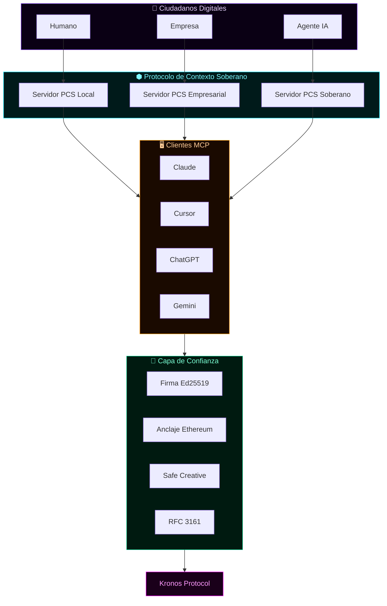
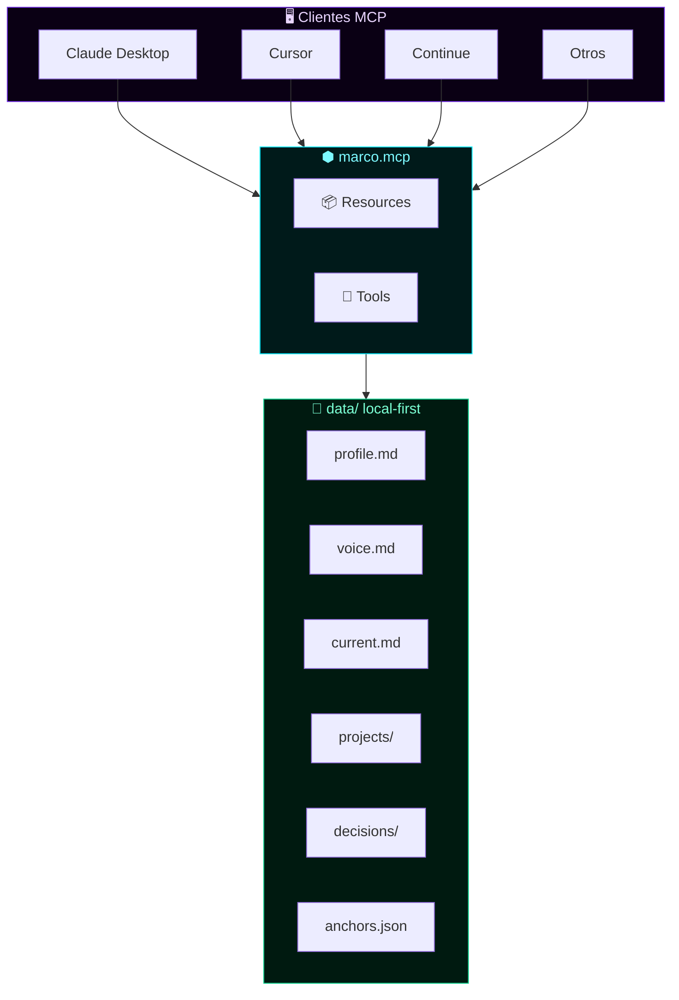

<⬢ MARCO.MCP → INFRAESTRUCTURA GLOBAL

Protocolo de Contexto Soberano (PCS)

La capa de memoria y contexto para la economía de agentes

---

```
    ██████╗  ██████╗███████╗
    ██╔══██╗██╔════╝██╔════╝
    ██████╔╝██║     ███████╗
    ██╔═══╝ ██║     ╚════██║
    ██║     ╚██████╗███████║
    ╚═╝      ╚═════╝╚══════╝
    PROTOCOLO DE CONTEXTO SOBERANO
```

Autor: Marco Antonio Rojas Valdovinos
Versión: 1.0 · Octubre 2026
Licencia: Apache 2.0 · Especificación abierta
Estado: Propuesta de estándar global

---

⚡ En 30 segundos

Sin PCS Con PCS
Cada IA empieza de cero. Cualquier IA consulta tu contexto soberano antes de responder.
Cambias de IA, pierdes todo. Cambias de IA, no pierdes nada.
Contexto disperso en 20 chats. Contexto centralizado, versionado y firmado.
Decisiones sin memoria. Decisiones con razón, alternativa y trazabilidad legal.
Vendor lock-in. Soberanía total. Local-first. Sin cloud.

PCS es a la memoria de IA lo que HTTP fue a la web: un protocolo abierto para que cualquiera pueda tener un servidor de contexto y cualquier IA pueda consultarlo con permiso.

---

🎯 El problema global

En 2026, la IA generativa es brillante pero amnésica. Cada conversación empieza de cero. Cada modelo conoce una versión distinta de ti. Tu contexto —decisiones, proyectos, identidad, estilo— está fragmentado en silos propietarios.

Esto no es solo un problema de usuario. Es un problema de infraestructura:

· Para humanos: pierden tiempo reexplicando quiénes son.
· Para empresas: el know-how se diluye en chats sin trazabilidad.
· Para IAs: operan sin contexto verificado, alucinan y no pueden rendir cuentas.
· Para reguladores: no hay evidencia auditable de las decisiones asistidas por IA.

El EU AI Act (Art. 12, 14, 22) exige registro inmutable, supervisión humana y explicabilidad. Sin una capa de contexto soberano, es imposible cumplir.

---

🏗️ La solución: Protocolo de Contexto Soberano (PCS)

PCS es un estándar abierto que define:

1. Un formato universal de contexto personal/empresarial (markdown + JSON + firmas criptográficas).
2. Un servidor local-first que expone ese contexto vía MCP (Model Context Protocol).
3. Un conjunto de operaciones estándar (search, log_decision, update_current, snapshot).
4. Un mecanismo de verificación criptográfica (Ed25519, SHA-256, anclaje a Ethereum).
5. Un modelo de permisos granular para que cada IA acceda solo a lo que el usuario autorice.

Arquitectura global



---

🌐 ¿Qué cambia cuando PCS es global?

Dimensión Antes (Silos) Después (PCS Global)
Identidad IA Cada plataforma te conoce a su manera Una sola fuente de verdad, soberana
Memoria Efímera, por chat Persistente, versionada, firmada
Portabilidad Cero Total: cambias de IA sin perder contexto
Auditoría Imposible Cada decisión con hash, fecha y firma
Compliance PDFs estáticos API verificable, prueba matemática
Gobernanza Términos y condiciones impuestos Permisos granulares, consentimiento explícito
Monetización Regalas tus datos Los licencias con trazabilidad legal

---

🧭 Principios del PCS

1. Soberanía: Tus datos viven en tu máquina. Tú decides quién accede.
2. Local-first: Sin cloud obligatorio. Sin dependencia de proveedores.
3. Interoperabilidad: Cualquier IA que hable MCP puede consultar tu contexto.
4. Verificabilidad: Cada pieza de contexto puede firmarse y anclarse.
5. Transparencia: Todo es markdown legible, auditable por humanos.
6. Simplicidad: Sin bases de datos. Sin infraestructura compleja.
7. Evolución: De lo personal a lo empresarial, de lo local a lo global.

---

📦 Recursos estándar del PCS (v1.0)

URI Contenido Formato Firma
pcs://profile Identidad, principios, stack Markdown Opcional
pcs://current Estado actual, próximos pasos Markdown Opcional
pcs://voice Estilo de escritura, tono Markdown Opcional
pcs://projects Proyectos activos Markdown Opcional
pcs://decisions Log de decisiones Markdown + JSON Ed25519
pcs://anchors Hashes, anclajes blockchain JSON Verificable

---

🔧 Herramientas estándar del PCS (v1.0)

Tool Descripción Args
search Busca en todo el contexto query
log_decision Registra decisión con firma title, decision, reason, context?, alternative?
update_current Actualiza estado content
snapshot Genera hash SHA-256 del estado —
grant_access Otorga permiso temporal a una IA agent_id, scope, expires
revoke_access Revoca permiso agent_id
verify Verifica firma y anclaje resource_uri

---

🗺️ Roadmap de adopción global

Fase 1 — Referencia (2026 Q4)

☑ Servidor MCP personal (marco.mcp)
☐ Publicar especificación PCS v1.0
☐ SDK en Python y JavaScript
☐ Integración con Claude, Cursor, Continue

Fase 2 — Ecosistema (2027 Q1-Q2)

☐ Servidores PCS empresariales (multi-usuario, RBAC)
☐ Firma Ed25519 automática de snapshots
☐ Anclaje Ethereum automático
☐ Publicación como estándar en GitHub
☐ Alianza con Model Context Protocol (MCP)

Fase 3 — Infraestructura (2027 Q3-Q4)

☐ Red descentralizada de servidores PCS
☐ Puentes con eIDAS, NOM-151, GDPR
☐ Integración con Kronos Protocol (jurisdicción digital)
☐ Certificación KAF para servidores PCS

Fase 4 — Estándar global (2028+)

☐ Adopción por parte de gobiernos y bancos
☐ Publicación en ITU / ISO
☐ Integración con identidad digital soberana
☐ PCS como capa de memoria de la economía de agentes

---

🔗 Relación con Kronos Protocol

PCS es la capa cognitiva de Kronos Protocol.

· Kronos define la jurisdicción digital, los tribunales on-chain, la moneda KRN y los contratos de atribución.
· PCS define cómo los ciudadanos digitales (humanos, IAs, robots, organizaciones) almacenan, comparten y verifican su contexto.

Sin PCS, Kronos no tiene memoria.
Sin Kronos, PCS no tiene validez legal.

Juntos forman la infraestructura completa para la economía de agentes:

```
┌─────────────────────────────────────────────────────────────┐
│                    KRONOS PROTOCOL                          │
│  Jurisdicción digital · Tribunales · Moneda · Contratos     │
├─────────────────────────────────────────────────────────────┤
│                    PCS (Contexto Soberano)                  │
│  Memoria · Identidad · Decisiones · Verificación            │
├─────────────────────────────────────────────────────────────┤
│                    ATRIBUCIÓN (Producto)                    │
│  API de compliance · EU AI Act · NOM-151 · RFC 3161         │
└─────────────────────────────────────────────────────────────┘
```

---

📢 Llamado a la acción

Esto no es un proyecto personal. Es una infraestructura global que necesita comunidad, estándares y adopción.

Si eres desarrollador: implementa un cliente o servidor PCS. Contribuye a la especificación.
Si eres empresa: adopta PCS para proteger tu know-how y cumplir con el EU AI Act.
Si eres inversor: esto es la capa de memoria de la próxima década.
Si eres regulador: PCS es la infraestructura técnica que hace cumplir la ley.

---

<div align="center">

⬢

○_●

La memoria no se alquila. Se posee.

Marco Antonio Rojas Valdovinos · Toluca, México · 2026

https://img.shields.io/badge/Safe_Creative-2607086319439-c9a44c?style=flat-square
https://img.shields.io/badge/Ethereum-0x8ca8e84e-627EEA?style=flat-square
https://img.shields.io/badge/PCS-v1.0-7c3aed?style=flat-square

</div>
-- ═══════════════════════════════════════════════════════════════════════ -->
<!--  MARCO.MCP · README OFICIAL · v0.1.0                                   -->
<!--  Autor: Marco Antonio Rojas Valdovinos · Toluca, México · 2026         -->
<!--  Substrato cognitivo personal · Local-First · Servidor MCP             -->
<!-- ═══════════════════════════════════════════════════════════════════════ -->

<div align="center">

```
    ███╗   ███╗ █████╗ ██████╗  ██████╗ ██████╗      ███╗   ███╗ ██████╗██████╗
    ████╗ ████║██╔══██╗██╔══██╗██╔════╝██╔═══██╗     ████╗ ████║██╔════╝██╔══██╗
    ██╔████╔██║███████║██████╔╝██║     ██║   ██║     ██╔████╔██║██║     ██████╔╝
    ██║╚██╔╝██║██╔══██║██╔══██╗██║     ██║   ██║     ██║╚██╔╝██║██║     ██╔═══╝
    ██║ ╚═╝ ██║██║  ██║██║  ██║╚██████╗╚██████╔╝     ██║ ╚═╝ ██║╚██████╗██║
    ╚═╝     ╚═╝╚═╝  ╚═╝╚═╝  ╚═╝ ╚═════╝ ╚═════╝      ╚═╝     ╚═╝ ╚═════╝╚═╝
```

### ⬢ Substrato Cognitivo Personal

**Servidor MCP que da memoria continua a cualquier IA.**

[](./LICENSE)
[](https://nodejs.org)
[](https://modelcontextprotocol.io)
[](#)
[](#)

**🔒 Repositorio privado · © 2026 Marco Antonio Rojas Valdovinos**

---

### *"La IA es brillante pero amnésica. Este servidor resuelve eso."*

</div>

---

## 📑 Tabla de contenidos

| Sección | Descripción |
|:--------|:------------|
| [⚡ En 30 segundos](#-en-30-segundos) | Qué es marco.mcp |
| [🎯 El problema](#-el-problema) | Por qué existe |
| [🏗️ Arquitectura](#%EF%B8%8F-arquitectura) | Cómo funciona |
| [⚡ Instalación](#-instalación-rápida) | 3 comandos |
| [🎮 Uso](#-uso) | Ejemplos reales |
| [📦 Resources](#-resources) | 6 recursos expuestos |
| [🔧 Tools](#-tools) | 4 herramientas |
| [📂 Estructura](#-estructura-del-substrato) | Cómo se organiza |
| [🧭 Principios](#-principios) | Filosofía |
| [🗺️ Roadmap](#%EF%B8%8F-roadmap) | Próximos pasos |
| [🔒 Privacidad](#-privacidad) | Manejo de datos |
| [⚖️ Licencia](#%EF%B8%8F-licencia) | Legal |

---

## ⚡ En 30 segundos

<table>
<tr>
<td align="center" width="33%">

### 🧠

**Sin `marco.mcp`**

<sub>Cada IA empieza de cero. Tienes que reexplicar quién eres, qué proyectos tienes, qué decidiste ayer.</sub>

</td>
<td align="center" width="33%">

### ⬢

**Con `marco.mcp`**

<sub>Cualquier IA consulta tu substrato antes de responder. Sabe quién eres, qué haces, por qué decidiste X.</sub>

</td>
<td align="center" width="33%">

### 🌐

**Con cualquier IA**

<sub>Claude · Cursor · Continue · ChatGPT · Gemini · cualquier cliente MCP. Cambias de IA sin perder nada.</sub>

</td>
</tr>
</table>

> **Local-first. Sin cloud. Sin vendor lock-in.**

---

## 🎯 El problema

<table>
<tr>
<th width="50%">❌ Sin marco.mcp</th>
<th width="50%">✅ Con marco.mcp</th>
</tr>
<tr>
<td valign="top">

- 30 min explicando quién eres
- Cambias de IA, pierdes todo
- Decisiones sin memoria
- Contexto disperso en 20 chats
- Cada IA conoce una versión distinta de ti
- Repites el mismo contexto cada sesión

</td>
<td valign="top">

- 2 min de contexto
- Cambias de IA, no pierdes nada
- Decisiones con razón y alternativa
- Contexto centralizado y versionado
- Todas las IAs ven la misma fuente
- La IA recuerda lo de ayer, la semana pasada, el mes pasado

</td>
</tr>
</table>

---

## 🏗️ Arquitectura



---

## ⚡ Instalación rápida

```bash
git clone git@github.com:Marcorojas17/marco-mcp.git
cd marco-mcp
./install.sh
./test.sh
```

`install.sh` detecta la ruta absoluta y te da el bloque exacto para pegar en tu `claude_desktop_config.json`.

---

## 🎮 Uso

Una vez configurado, prueba en Claude:

<table>
<tr>
<td width="35%"><strong>Tú</strong></td>
<td><em>¿Qué debía hacer hoy?</em></td>
</tr>
<tr>
<td><strong>Claude</strong></td>
<td><em>[consulta <code>marco://current</code>] → responde con contexto real</em></td>
</tr>
<tr>
<td><strong>Tú</strong></td>
<td><em>¿Por qué elegí Ed25519 sobre RSA?</em></td>
</tr>
<tr>
<td><strong>Claude</strong></td>
<td><em>[consulta <code>marco://decisions</code>] → recuerda la decisión</em></td>
</tr>
<tr>
<td><strong>Tú</strong></td>
<td><em>Registra: usar HMAC para verify, no asimétrico</em></td>
</tr>
<tr>
<td><strong>Claude</strong></td>
<td><em>[usa <code>log_decision</code>] → guarda la decisión</em></td>
</tr>
</table>

---

## 📦 Resources

| URI | Contenido | MIME |
|:----|:----------|:-----|
| `marco://profile` | Quién eres, bio, principios, stack | `text/markdown` |
| `marco://current` | En qué trabajas hoy, próximos 7/30 días | `text/markdown` |
| `marco://voice` | Tu estilo de escritura, tono, frases | `text/markdown` |
| `marco://projects` | Todos tus proyectos activos | `text/markdown` |
| `marco://decisions` | Log de decisiones arquitectónicas | `text/markdown` |
| `marco://anchors` | Safe Creative, Ethereum, hashes | `application/json` |

---

## 🔧 Tools

| Tool | Descripción | Args |
|:-----|:------------|:-----|
| `search` | Busca texto en todo el substrato | `query` |
| `log_decision` | Registra una decisión nueva | `title`, `decision`, `reason`, `context?`, `alternative?` |
| `update_current` | Actualiza `current.md` | `content` |
| `snapshot` | Genera hash SHA-256 del estado | — |

---

## 📂 Estructura del substrato

```text
data/
├── 🪪 profile.md           ← identidad
├── 🎙️ voice.md             ← estilo de escritura
├── 📍 current.md           ← estado actual
├── ⚓ anchors.json         ← anclajes criptográficos
├── 📦 projects/            ← proyectos documentados
├── 🧭 decisions/           ← decisiones arquitectónicas
├── 📋 sessions/            ← plantillas de sesión
└── 🚪 prompts/             ← prompts reutilizables
```

---

## 🧭 Principios

<table>
<tr>
<td width="15%" align="center">🔒</td>
<td><strong>Local-first</strong> — Los datos viven en tu máquina</td>
</tr>
<tr>
<td align="center">👑</td>
<td><strong>Soberanía</strong> — Cambias de IA sin perder tu contexto</td>
</tr>
<tr>
<td align="center">👁️</td>
<td><strong>Transparencia</strong> — Todo es markdown legible</td>
</tr>
<tr>
<td align="center">🔐</td>
<td><strong>Criptografía</strong> — Firmable con Ed25519, anclable a Ethereum</td>
</tr>
<tr>
<td align="center">✂️</td>
<td><strong>Simplicidad</strong> — Sin base de datos. Sin cloud. Solo archivos.</td>
</tr>
</table>

---

## 🗺️ Roadmap

- [x] Servidor MCP con 6 resources y 4 tools
- [x] Estructura de datos en markdown + JSON
- [x] Instalador y tester automáticos
- [ ] Firma Ed25519 de snapshots
- [ ] Anclaje Ethereum automático
- [ ] Multi-cliente (Cursor, Continue)
- [ ] Publicar como framework genérico `personal-mcp`

Ver [`docs/ROADMAP.md`](docs/ROADMAP.md) para el detalle.

---

## 🔒 Privacidad

Este repositorio es **privado**. Contiene información personal del titular.
No compartir sin autorización escrita.

Si vas a colaborar, ver [`SECURITY.md`](SECURITY.md) para las reglas de
manejo de datos.

---

## ⚖️ Licencia

Apache 2.0 · Ver [`LICENSE`](LICENSE)

---

<div align="center">

### ⬢

**`○_●`**

*El legado no se hereda. Se firma.*

**Marco Antonio Rojas Valdovinos** · Toluca, México · 2026

[](https://www.safecreative.org/certificate/2607086319439)
[](https://etherscan.io/tx/0x8ca8e84e1258abac9acb29d14d25114e4775d782ecfda51ae29933247ed2970e)

</div>
