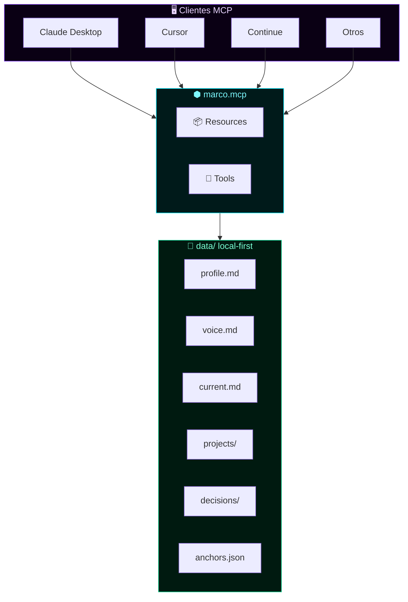

<!-- ═══════════════════════════════════════════════════════════════════════ -->
<!--  MARCO.MCP · README OFICIAL · v0.1.0                                   -->
<!--  Autor: Marco Antonio Rojas Valdovinos · Toluca, México · 2026         -->
<!--  Substrato cognitivo personal · Local-First · Servidor MCP             -->
<!-- ═══════════════════════════════════════════════════════════════════════ -->

<div align="center">

```
    ███╗   ███╗ █████╗ ██████╗  ██████╗ ██████╗      ███╗   ███╗ ██████╗██████╗
    ████╗ ████║██╔══██╗██╔══██╗██╔════╝██╔═══██╗     ████╗ ████║██╔════╝██╔══██╗
    ██╔████╔██║███████║██████╔╝██║     ██║   ██║     ██╔████╔██║██║     ██████╔╝
    ██║╚██╔╝██║██╔══██║██╔══██╗██║     ██║   ██║     ██║╚██╔╝██║██║     ██╔═══╝
    ██║ ╚═╝ ██║██║  ██║██║  ██║╚██████╗╚██████╔╝     ██║ ╚═╝ ██║╚██████╗██║
    ╚═╝     ╚═╝╚═╝  ╚═╝╚═╝  ╚═╝ ╚═════╝ ╚═════╝      ╚═╝     ╚═╝ ╚═════╝╚═╝
```

### ⬢ Substrato Cognitivo Personal

**Servidor MCP que da memoria continua a cualquier IA.**

[](./LICENSE)
[](https://nodejs.org)
[](https://modelcontextprotocol.io)
[](#)
[](#)

**🔒 Repositorio privado · © 2026 Marco Antonio Rojas Valdovinos**

---

### *"La IA es brillante pero amnésica. Este servidor resuelve eso."*

</div>

---

## 📑 Tabla de contenidos

| Sección | Descripción |
|:--------|:------------|
| [⚡ En 30 segundos](#-en-30-segundos) | Qué es marco.mcp |
| [🎯 El problema](#-el-problema) | Por qué existe |
| [🏗️ Arquitectura](#%EF%B8%8F-arquitectura) | Cómo funciona |
| [⚡ Instalación](#-instalación-rápida) | 3 comandos |
| [🎮 Uso](#-uso) | Ejemplos reales |
| [📦 Resources](#-resources) | 6 recursos expuestos |
| [🔧 Tools](#-tools) | 4 herramientas |
| [📂 Estructura](#-estructura-del-substrato) | Cómo se organiza |
| [🧭 Principios](#-principios) | Filosofía |
| [🗺️ Roadmap](#%EF%B8%8F-roadmap) | Próximos pasos |
| [🔒 Privacidad](#-privacidad) | Manejo de datos |
| [⚖️ Licencia](#%EF%B8%8F-licencia) | Legal |

---

## ⚡ En 30 segundos

<table>
<tr>
<td align="center" width="33%">

### 🧠

**Sin `marco.mcp`**

<sub>Cada IA empieza de cero. Tienes que reexplicar quién eres, qué proyectos tienes, qué decidiste ayer.</sub>

</td>
<td align="center" width="33%">

### ⬢

**Con `marco.mcp`**

<sub>Cualquier IA consulta tu substrato antes de responder. Sabe quién eres, qué haces, por qué decidiste X.</sub>

</td>
<td align="center" width="33%">

### 🌐

**Con cualquier IA**

<sub>Claude · Cursor · Continue · ChatGPT · Gemini · cualquier cliente MCP. Cambias de IA sin perder nada.</sub>

</td>
</tr>
</table>

> **Local-first. Sin cloud. Sin vendor lock-in.**

---

## 🎯 El problema

<table>
<tr>
<th width="50%">❌ Sin marco.mcp</th>
<th width="50%">✅ Con marco.mcp</th>
</tr>
<tr>
<td valign="top">

- 30 min explicando quién eres
- Cambias de IA, pierdes todo
- Decisiones sin memoria
- Contexto disperso en 20 chats
- Cada IA conoce una versión distinta de ti
- Repites el mismo contexto cada sesión

</td>
<td valign="top">

- 2 min de contexto
- Cambias de IA, no pierdes nada
- Decisiones con razón y alternativa
- Contexto centralizado y versionado
- Todas las IAs ven la misma fuente
- La IA recuerda lo de ayer, la semana pasada, el mes pasado

</td>
</tr>
</table>

---

## 🏗️ Arquitectura



---

## ⚡ Instalación rápida

```bash
git clone git@github.com:Marcorojas17/marco-mcp.git
cd marco-mcp
./install.sh
./test.sh
```

`install.sh` detecta la ruta absoluta y te da el bloque exacto para pegar en tu `claude_desktop_config.json`.

---

## 🎮 Uso

Una vez configurado, prueba en Claude:

<table>
<tr>
<td width="35%"><strong>Tú</strong></td>
<td><em>¿Qué debía hacer hoy?</em></td>
</tr>
<tr>
<td><strong>Claude</strong></td>
<td><em>[consulta <code>marco://current</code>] → responde con contexto real</em></td>
</tr>
<tr>
<td><strong>Tú</strong></td>
<td><em>¿Por qué elegí Ed25519 sobre RSA?</em></td>
</tr>
<tr>
<td><strong>Claude</strong></td>
<td><em>[consulta <code>marco://decisions</code>] → recuerda la decisión</em></td>
</tr>
<tr>
<td><strong>Tú</strong></td>
<td><em>Registra: usar HMAC para verify, no asimétrico</em></td>
</tr>
<tr>
<td><strong>Claude</strong></td>
<td><em>[usa <code>log_decision</code>] → guarda la decisión</em></td>
</tr>
</table>

---

## 📦 Resources

| URI | Contenido | MIME |
|:----|:----------|:-----|
| `marco://profile` | Quién eres, bio, principios, stack | `text/markdown` |
| `marco://current` | En qué trabajas hoy, próximos 7/30 días | `text/markdown` |
| `marco://voice` | Tu estilo de escritura, tono, frases | `text/markdown` |
| `marco://projects` | Todos tus proyectos activos | `text/markdown` |
| `marco://decisions` | Log de decisiones arquitectónicas | `text/markdown` |
| `marco://anchors` | Safe Creative, Ethereum, hashes | `application/json` |

---

## 🔧 Tools

| Tool | Descripción | Args |
|:-----|:------------|:-----|
| `search` | Busca texto en todo el substrato | `query` |
| `log_decision` | Registra una decisión nueva | `title`, `decision`, `reason`, `context?`, `alternative?` |
| `update_current` | Actualiza `current.md` | `content` |
| `snapshot` | Genera hash SHA-256 del estado | — |

---

## 📂 Estructura del substrato

```text
data/
├── 🪪 profile.md           ← identidad
├── 🎙️ voice.md             ← estilo de escritura
├── 📍 current.md           ← estado actual
├── ⚓ anchors.json         ← anclajes criptográficos
├── 📦 projects/            ← proyectos documentados
├── 🧭 decisions/           ← decisiones arquitectónicas
├── 📋 sessions/            ← plantillas de sesión
└── 🚪 prompts/             ← prompts reutilizables
```

---

## 🧭 Principios

<table>
<tr>
<td width="15%" align="center">🔒</td>
<td><strong>Local-first</strong> — Los datos viven en tu máquina</td>
</tr>
<tr>
<td align="center">👑</td>
<td><strong>Soberanía</strong> — Cambias de IA sin perder tu contexto</td>
</tr>
<tr>
<td align="center">👁️</td>
<td><strong>Transparencia</strong> — Todo es markdown legible</td>
</tr>
<tr>
<td align="center">🔐</td>
<td><strong>Criptografía</strong> — Firmable con Ed25519, anclable a Ethereum</td>
</tr>
<tr>
<td align="center">✂️</td>
<td><strong>Simplicidad</strong> — Sin base de datos. Sin cloud. Solo archivos.</td>
</tr>
</table>

---

## 🗺️ Roadmap

- [x] Servidor MCP con 6 resources y 4 tools
- [x] Estructura de datos en markdown + JSON
- [x] Instalador y tester automáticos
- [ ] Firma Ed25519 de snapshots
- [ ] Anclaje Ethereum automático
- [ ] Multi-cliente (Cursor, Continue)
- [ ] Publicar como framework genérico `personal-mcp`

Ver [`docs/ROADMAP.md`](docs/ROADMAP.md) para el detalle.

---

## 🔒 Privacidad

Este repositorio es **privado**. Contiene información personal del titular.
No compartir sin autorización escrita.

Si vas a colaborar, ver [`SECURITY.md`](SECURITY.md) para las reglas de
manejo de datos.

---

## ⚖️ Licencia

Apache 2.0 · Ver [`LICENSE`](LICENSE)

---

<div align="center">

### ⬢

**`○_●`**

*El legado no se hereda. Se firma.*

**Marco Antonio Rojas Valdovinos** · Toluca, México · 2026

[](https://www.safecreative.org/certificate/2607086319439)
[](https://etherscan.io/tx/0x8ca8e84e1258abac9acb29d14d25114e4775d782ecfda51ae29933247ed2970e)

</div>