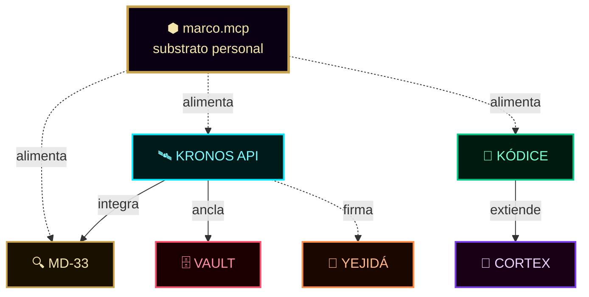

<!-- ═══════════════════════════════════════════════════════════════════════ -->
<!--  MARCO.MCP · data/projects/_index.md                                   -->
<!--  Índice maestro de proyectos activos                                   -->
<!--  Autor: Marco Antonio Rojas Valdovinos · Toluca, México · 2026         -->
<!-- ═══════════════════════════════════════════════════════════════════════ -->

<div align="center">

```
    ╔═══════════════════════════════════════════════════════════════╗
    ║                                                               ║
    ║        ██████╗ ██████╗  ██████╗      ██╗███████╗ ██████╗ ████████╗
    ║        ██╔══██╗██╔══██╗██╔═══██╗     ██║██╔════╝██╔════╝ ╚══██╔══╝
    ║        ██████╔╝██████╔╝██║   ██║     ██║█████╗  ██║         ██║
    ║        ██╔═══╝ ██╔══██╗██║   ██║██   ██║██╔══╝  ██║         ██║
    ║        ██║     ██║  ██║╚██████╔╝╚█████╔╝███████╗╚██████╗    ██║
    ║        ╚═╝     ╚═╝  ╚═╝ ╚═════╝  ╚════╝ ╚══════╝ ╚═════╝    ╚═╝
    ║                                                               ║
    ╚═══════════════════════════════════════════════════════════════╝
```

# 📦 Proyectos

### Índice maestro del ecosistema

*7 proyectos activos. Cada uno con estado, mercado y próximo paso.*

[](.)
[](.)
[](.)

**`○_●`** &nbsp;·&nbsp; **Un ecosistema, no proyectos sueltos**

</div>

---

## 📑 Índice

| Sección | Contenido |
|:--------|:----------|
| [📊 Vista panorámica](#-vista-panorámica) | Tabla general |
| [🚦 Semáforo](#-semáforo-de-estados) | Estados posibles |
| [🎯 Prioridad actual](#-prioridad-actual) | Orden de ataque |
| [🔗 Conexiones](#-conexiones-entre-proyectos) | Cómo se enlazan |
| [📋 Detalle](#-detalle-por-proyecto) | Enlaces a cada proyecto |

---

## 📊 Vista panorámica

<table>
<tr>
<th width="5%">#</th>
<th width="25%">Proyecto</th>
<th width="15%" align="center">Estado</th>
<th width="55%">Próximo paso</th>
</tr>
<tr>
<td align="center"><code>01</code></td>
<td><strong>⬢ marco.mcp</strong></td>
<td align="center">🟡 Construcción</td>
<td>Probar en Claude Desktop</td>
</tr>
<tr>
<td align="center"><code>02</code></td>
<td><strong>🛰️ KRONOS API</strong></td>
<td align="center">🟡 Parches</td>
<td>Rate limit + HMAC determinista</td>
</tr>
<tr>
<td align="center"><code>03</code></td>
<td><strong>🧬 KÓDICE</strong></td>
<td align="center">🔴 Bug</td>
<td>Fix llaves Ed25519 desde ENV</td>
</tr>
<tr>
<td align="center"><code>04</code></td>
<td><strong>🌊 YEJIDÁ</strong></td>
<td align="center">🟢 Funcional</td>
<td>Fusionar 3 HTML duplicados</td>
</tr>
<tr>
<td align="center"><code>05</code></td>
<td><strong>🔍 MD-33</strong></td>
<td align="center">🟢 Usable</td>
<td>Integrar con KRONOS API</td>
</tr>
<tr>
<td align="center"><code>06</code></td>
<td><strong>🗄️ VAULT</strong></td>
<td align="center">🟡 Génesis</td>
<td>Schema testamento criptográfico</td>
</tr>
<tr>
<td align="center"><code>07</code></td>
<td><strong>🧠 CORTEX</strong></td>
<td align="center">🟡 Especificación</td>
<td>Fase 1: consejo mínimo</td>
</tr>
</table>

---

## 🚦 Semáforo de estados

<table>
<tr>
<td width="15%" align="center"><strong>🟢 Funcional</strong></td>
<td>Listo para producción o uso real. Sin bloqueadores.</td>
</tr>
<tr>
<td align="center"><strong>🟡 En desarrollo</strong></td>
<td>Parcialmente implementado. Falta trabajo conocido.</td>
</tr>
<tr>
<td align="center"><strong>🔴 Bloqueado</strong></td>
<td>Requiere intervención urgente. Bug crítico o dependencia externa.</td>
</tr>
<tr>
<td align="center"><strong>⚫ Archivado</strong></td>
<td>Sin desarrollo activo. Preservado por referencia.</td>
</tr>
</table>

---

## 🎯 Prioridad actual

<table>
<tr>
<td align="center" width="60px"><strong>1️⃣</strong></td>
<td><strong>marco.mcp</strong> · el substrato cognitivo precede todo lo demás</td>
</tr>
<tr>
<td align="center"><strong>2️⃣</strong></td>
<td><strong>KRONOS API</strong> · parches de seguridad desbloquean comercialización</td>
</tr>
<tr>
<td align="center"><strong>3️⃣</strong></td>
<td><strong>KÓDICE</strong> · bug crítico impide funcionamiento real</td>
</tr>
<tr>
<td align="center"><strong>4️⃣</strong></td>
<td><strong>RFC-001 a RFC-005</strong> · publicación como estándar</td>
</tr>
<tr>
<td align="center"><strong>5️⃣</strong></td>
<td><strong>MD-33 FORENSE</strong> · integración con KRONOS API</td>
</tr>
<tr>
<td align="center"><strong>6️⃣</strong></td>
<td><strong>YEJIDÁ</strong> · fusionar HTML duplicados</td>
</tr>
<tr>
<td align="center"><strong>7️⃣</strong></td>
<td><strong>VAULT + CORTEX</strong> · visión a 12-24 meses</td>
</tr>
</table>

---

## 🔗 Conexiones entre proyectos



---

## 📋 Detalle por proyecto

<table>
<tr>
<th width="30%">Proyecto</th>
<th width="70%">Documento completo</th>
</tr>
<tr>
<td><strong>🛰️ KRONOS API</strong></td>
<td><a href="./kronos-api.md"><code>projects/kronos-api.md</code></a></td>
</tr>
<tr>
<td><strong>🧬 KÓDICE</strong></td>
<td><a href="./kodice.md"><code>projects/kodice.md</code></a></td>
</tr>
<tr>
<td><strong>🌊 YEJIDÁ</strong></td>
<td><a href="./yejida.md"><code>projects/yejida.md</code></a></td>
</tr>
<tr>
<td><strong>🔍 MD-33 FORENSE</strong></td>
<td><a href="./md33.md"><code>projects/md33.md</code></a></td>
</tr>
<tr>
<td><strong>🗄️ KRONOS VAULT</strong></td>
<td><a href="./vault.md"><code>projects/vault.md</code></a></td>
</tr>
<tr>
<td><strong>🧠 CORTEX V13</strong></td>
<td><a href="./cortex.md"><code>projects/cortex.md</code></a></td>
</tr>
</table>

---

<div align="center">

### 📦

```
    ┌─────────────────────────────────────────────────┐
    │  Un proyecto suelto es una idea.                │
    │  Un ecosistema es una arquitectura.             │
    │                                                 │
    │  ── Siete piezas, un solo propósito ──          │
    └─────────────────────────────────────────────────┘
```

**⬢ marco.mcp · data/projects/_index.md**

*Cada proyecto es una promesa en construcción.*

© 2026 Marco Antonio Rojas Valdovinos · `DMD-33 ●_○`

</div>