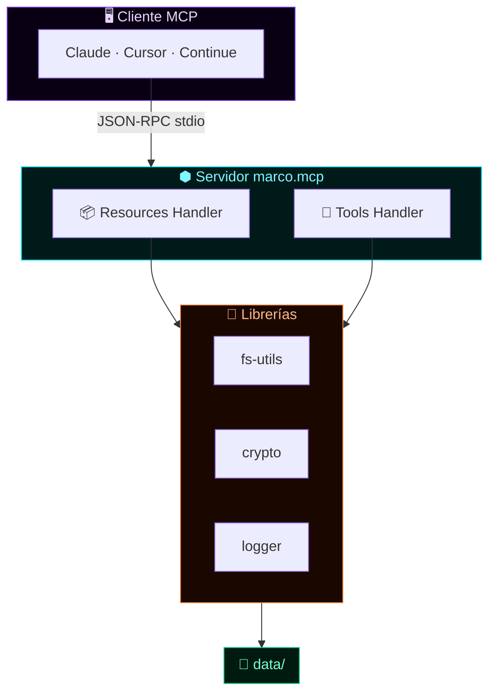
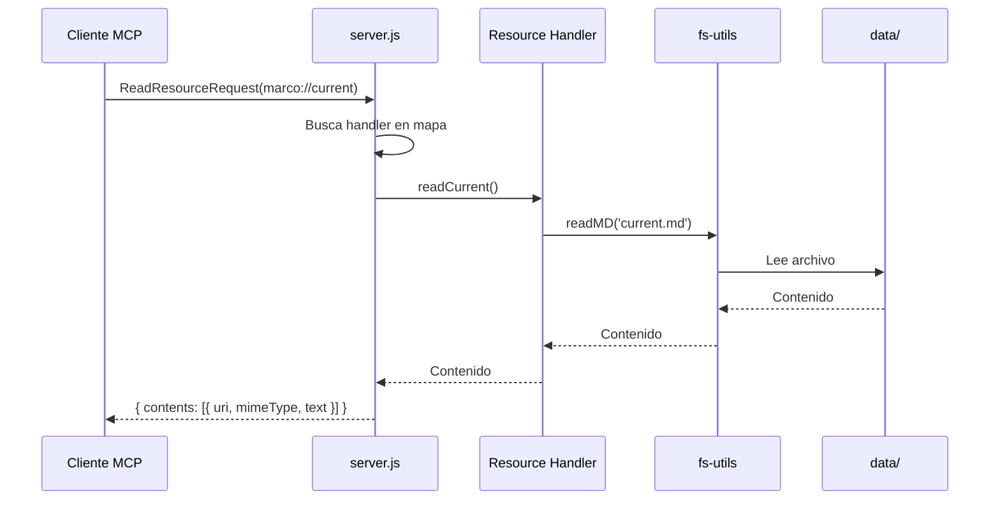
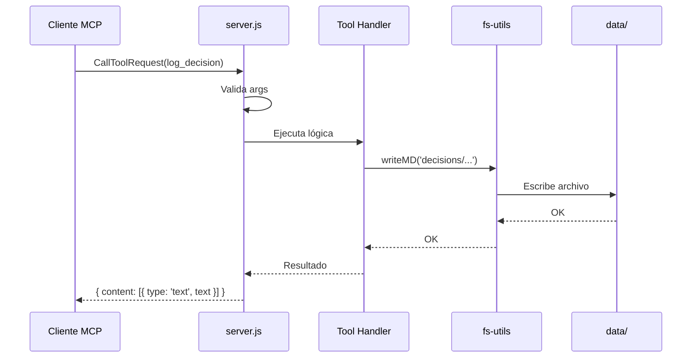

<!-- ═══════════════════════════════════════════════════════════════════════ -->
<!--  MARCO.MCP · docs/ARCHITECTURE.md                                      -->
<!--  Arquitectura técnica del servidor MCP                                 -->
<!--  Autor: Marco Antonio Rojas Valdovinos · Toluca, México · 2026         -->
<!-- ═══════════════════════════════════════════════════════════════════════ -->

<div align="center">

```
    ╔═══════════════════════════════════════════════════════════════╗
    ║                                                               ║
    ║   █████╗ ██████╗  ██████╗██╗  ██╗██╗████████╗███████╗ ██████╗  ║
    ║  ██╔══██╗██╔══██╗██╔════╝██║  ██║██║╚══██╔══╝██╔════╝██╔════╝  ║
    ║  ███████║██████╔╝██║     ███████║██║   ██║   █████╗  ██║       ║
    ║  ██╔══██║██╔══██╗██║     ██╔══██║██║   ██║   ██╔══╝  ██║       ║
    ║  ██║  ██║██║  ██║╚██████╗██║  ██║██║   ██║   ███████╗╚██████╗  ║
    ║  ╚═╝  ╚═╝╚═╝  ╚═╝ ╚═════╝╚═╝  ╚═╝╚═╝   ╚═╝   ╚══════╝ ╚═════╝  ║
    ║                                                               ║
    ╚═══════════════════════════════════════════════════════════════╝
```

# 🏗️ Arquitectura

### marco.mcp

*Servidor MCP · stdio transport · local-first*

[](.)
[](.)
[](.)

**`○_●`** &nbsp;·&nbsp; **La estructura es el argumento**

</div>

---

## 📑 Índice

| Sección | Contenido |
|:--------|:----------|
| [🧱 Capas](#-capas) | Vista general |
| [🔀 Flujo de consulta](#-flujo-de-una-consulta) | Cómo se resuelve un resource |
| [🔧 Flujo de tool](#-flujo-de-una-tool) | Cómo se ejecuta una tool |
| [📂 Estructura](#-estructura-de-datos) | Cómo se organiza data/ |
| [🔐 Criptografía](#-criptografía) | Firma y hash |
| [🚀 Extensiones](#-extensiones-futuras) | Roadmap técnico |

---

## 🧱 Capas



---

## 🔀 Flujo de una consulta



---

## 🔧 Flujo de una tool



---

## 📂 Estructura de datos

```text
data/
├── 🪪 profile.md           ← identidad del titular
├── 🎙️ voice.md             ← estilo de escritura
├── 📍 current.md           ← estado actual
├── ⚓ anchors.json         ← anclajes criptográficos
│
├── 📦 projects/            ← proyectos documentados
│   ├── _index.md
│   ├── kronos-api.md
│   ├── kodice.md
│   ├── yejida.md
│   ├── md33.md
│   ├── vault.md
│   └── cortex.md
│
├── 🧭 decisions/           ← decisiones arquitectónicas
│   ├── _index.md
│   └── 2026-*.md
│
├── 📋 sessions/            ← plantillas de sesión
│   └── _template.md
│
└── 🚪 prompts/             ← prompts reutilizables
    ├── onboarding.md
    ├── review.md
    └── handoff.md
```

**Todo es markdown + JSON. Sin base de datos. Sin cloud.**

### Ventajas

<table>
<tr><td align="center" width="30px">✅</td><td>Legible por humanos</td></tr>
<tr><td align="center">✅</td><td>Versionable con git</td></tr>
<tr><td align="center">✅</td><td>Editable con cualquier editor</td></tr>
<tr><td align="center">✅</td><td>Portable (sin vendor lock-in)</td></tr>
<tr><td align="center">✅</td><td>Compatible con Obsidian</td></tr>
</table>

### Desventajas

<table>
<tr><td align="center" width="30px">⚠️</td><td>Sin queries complejas</td></tr>
<tr><td align="center">⚠️</td><td>Performance limitada en substratos grandes (&gt;10 MB)</td></tr>
</table>

---

## 🔐 Criptografía

<table>
<tr>
<th width="30%">Componente</th>
<th width="30%">Estándar</th>
<th width="40%">Uso</th>
</tr>
<tr>
<td><strong>Hash</strong></td>
<td>SHA-256</td>
<td>Huella del substrato completo</td>
</tr>
<tr>
<td><strong>Firma</strong></td>
<td>Ed25519</td>
<td>Firma de snapshots (RFC 8032)</td>
</tr>
<tr>
<td><strong>Aleatoriedad</strong></td>
<td>CSPRNG</td>
<td><code>crypto.randomBytes</code></td>
</tr>
</table>

### Firma de snapshots

El script `src/snapshot.js` puede firmar el hash del substrato con la
clave privada Ed25519 configurada en `ED25519_PRIVATE_KEY`. La firma se
guarda en `snapshots/` junto con el hash.

**Sin la clave, sigue funcionando en modo degradado** (solo hash, sin firma).

---

## 🚀 Extensiones futuras

<table>
<tr>
<td align="center" width="30px">⛓️</td>
<td><strong>Anclaje Ethereum:</strong> publicar hash a mainnet una vez al mes</td>
</tr>
<tr>
<td align="center">🌐</td>
<td><strong>Multi-cliente:</strong> soporte para WebSocket además de stdio</td>
</tr>
<tr>
<td align="center">☁️</td>
<td><strong>Sync cifrado:</strong> replicar a IPFS/Arweave</td>
</tr>
<tr>
<td align="center">👥</td>
<td><strong>Multi-usuario:</strong> soporte para equipos</td>
</tr>
<tr>
<td align="center">🧩</td>
<td><strong>Framework genérico:</strong> publicar como <code>personal-mcp</code></td>
</tr>
</table>

---

<div align="center">

### 🏗️

```
    ┌─────────────────────────────────────────────────┐
    │  La arquitectura no es decoración.              │
    │  Es el argumento principal.                     │
    │                                                 │
    │  ── La estructura es el argumento ──            │
    └─────────────────────────────────────────────────┘
```

**⬢ marco.mcp · docs/ARCHITECTURE.md**

*La estructura es el argumento.*

© 2026 Marco Antonio Rojas Valdovinos · `DMD-33 ●_○`

</div>