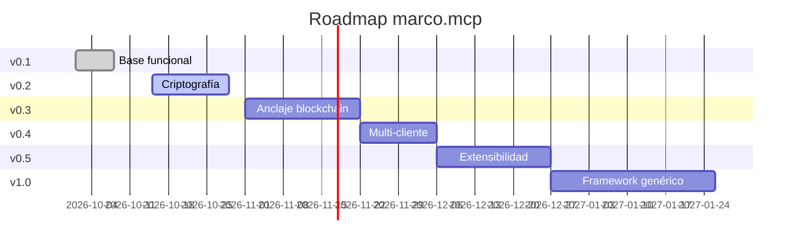

<!-- ═══════════════════════════════════════════════════════════════════════ -->
<!--  MARCO.MCP · docs/ROADMAP.md                                           -->
<!--  Roadmap público con versiones y milestones                            -->
<!--  Autor: Marco Antonio Rojas Valdovinos · Toluca, México · 2026         -->
<!-- ═══════════════════════════════════════════════════════════════════════ -->

<div align="center">

```
    ╔═══════════════════════════════════════════════════════════════╗
    ║                                                               ║
    ║       ██████╗  ██████╗  █████╗ ██████╗ ███╗   ███╗ █████╗ ██████╗║
    ║       ██╔══██╗██╔═══██╗██╔══██╗██╔══██╗████╗ ████║██╔══██╗██╔══██╗║
    ║       ██████╔╝██║   ██║███████║██║  ██║██╔████╔██║███████║██████╔╝║
    ║       ██╔══██╗██║   ██║██╔══██║██║  ██║██║╚██╔╝██║██╔══██║██╔══██╗║
    ║       ██║  ██║╚██████╔╝██║  ██║██████╔╝██║ ╚═╝ ██║██║  ██║██║  ██║║
    ║       ╚═╝  ╚═╝ ╚═════╝ ╚═╝  ╚═╝╚═════╝ ╚═╝     ╚═╝╚═╝  ╚═╝╚═╝  ╚═╝║
    ║                                                               ║
    ╚═══════════════════════════════════════════════════════════════╝
```

# 🗺️ Roadmap

### Plan de desarrollo

*Del estado actual al framework genérico.*

[](.)
[](.)
[](.)

**`○_●`** &nbsp;·&nbsp; **El futuro se construye hoy o no se construye**

</div>

---

## 📑 Índice

| Versión | Enfoque |
|:--------|:--------|
| [v0.1 ✅](#-v01--base-funcional-) | Base funcional |
| [v0.2 🎯](#-v02--criptografía) | Criptografía |
| [v0.3 ⛓️](#-v03--anclaje-blockchain) | Anclaje blockchain |
| [v0.4 🌐](#-v04--multi-cliente) | Multi-cliente |
| [v0.5 🧩](#-v05--extensibilidad) | Extensibilidad |
| [v1.0 🚀](#-v10--publicación-framework) | Publicación framework |

---

## v0.1 · Base funcional ✅

<table>
<tr><td align="center" width="30px">✅</td><td>Servidor MCP con stdio</td></tr>
<tr><td align="center">✅</td><td>6 resources (profile, current, voice, projects, decisions, anchors)</td></tr>
<tr><td align="center">✅</td><td>4 tools (search, log_decision, update_current, snapshot)</td></tr>
<tr><td align="center">✅</td><td>Estructura de datos completa</td></tr>
<tr><td align="center">✅</td><td>Instalador y tester</td></tr>
<tr><td align="center">✅</td><td>Config de Claude Desktop</td></tr>
<tr><td align="center">✅</td><td>Documentación premium</td></tr>
</table>

---

## v0.2 · Criptografía

<table>
<tr><td align="center" width="30px">⬜</td><td>Firma Ed25519 automática de snapshots</td></tr>
<tr><td align="center">⬜</td><td>Carga de clave desde archivo seguro</td></tr>
<tr><td align="center">⬜</td><td>Verificación de firma en tools</td></tr>
<tr><td align="center">⬜</td><td>Test vectors para validación</td></tr>
<tr><td align="center">⬜</td><td>Documentación de rotación de claves</td></tr>
</table>

---

## v0.3 · Anclaje blockchain

<table>
<tr><td align="center" width="30px">⬜</td><td>Script de anclaje a Ethereum (vía Safe Creative o directo)</td></tr>
<tr><td align="center">⬜</td><td>Guardar <code>tx_hash</code> en snapshots</td></tr>
<tr><td align="center">⬜</td><td>Verificación pública por terceros</td></tr>
<tr><td align="center">⬜</td><td>Comando <code>npm run anchor</code></td></tr>
</table>

---

## v0.4 · Multi-cliente

<table>
<tr><td align="center" width="30px">⬜</td><td>Soporte WebSocket</td></tr>
<tr><td align="center">⬜</td><td>Configuración para Cursor</td></tr>
<tr><td align="center">⬜</td><td>Configuración para Continue</td></tr>
<tr><td align="center">⬜</td><td>Documentación de compatibilidad</td></tr>
<tr><td align="center">⬜</td><td>Test con 3 clientes diferentes</td></tr>
</table>

---

## v0.5 · Extensibilidad

<table>
<tr><td align="center" width="30px">⬜</td><td>Sistema de plugins para tools personalizados</td></tr>
<tr><td align="center">⬜</td><td>Webhooks para integraciones externas</td></tr>
<tr><td align="center">⬜</td><td>API REST paralela (opcional)</td></tr>
<tr><td align="center">⬜</td><td>CLI para gestionar el substrato</td></tr>
</table>

---

## v1.0 · Publicación framework

<table>
<tr><td align="center" width="30px">⬜</td><td>Versión genérica sin datos personales</td></tr>
<tr><td align="center">⬜</td><td>Publicar como <code>personal-mcp</code> open source</td></tr>
<tr><td align="center">⬜</td><td>Documentación completa</td></tr>
<tr><td align="center">⬜</td><td>Casos de uso de terceros</td></tr>
<tr><td align="center">⬜</td><td>Publicación en npm</td></tr>
<tr><td align="center">⬜</td><td>Tutorial de instalación para nuevos usuarios</td></tr>
</table>

---

## 📅 Timeline estimado



---

<div align="center">

### 🗺️

```
    ┌─────────────────────────────────────────────────┐
    │  Un roadmap sin fechas es una lista de deseos.  │
    │  Un roadmap con fechas es un compromiso.        │
    │                                                 │
    │  ── Construye hoy o no construyas nada ──       │
    └─────────────────────────────────────────────────┘
```

**⬢ marco.mcp · docs/ROADMAP.md**

*El futuro se construye hoy o no se construye.*

© 2026 Marco Antonio Rojas Valdovinos · `DMD-33 ●_○`

</div>